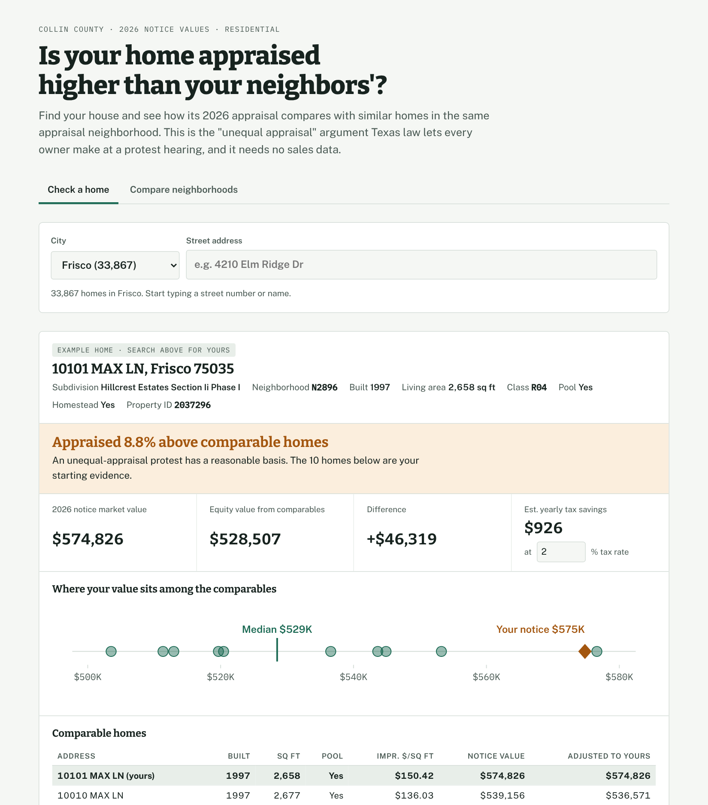
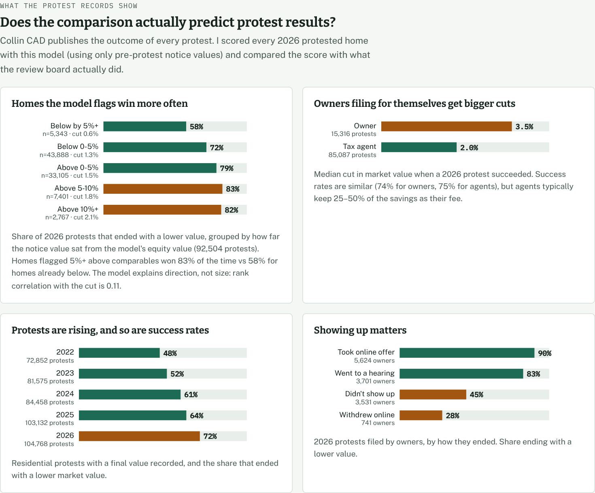
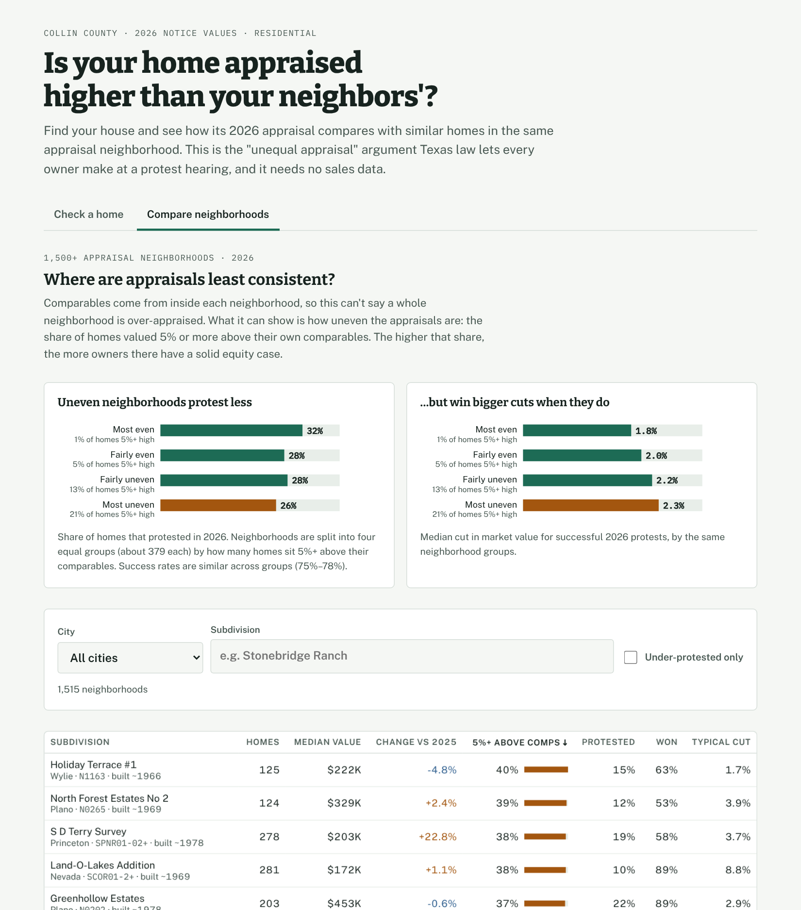

# Collin Equity Check

**Live site:** https://YOUR-USERNAME.github.io/collin-equity-check/

**Is your home appraised higher than your neighbors'?** A free tool for Collin County, Texas homeowners that compares any home's appraisal with its closest comparable homes and builds the evidence for an "unequal appraisal" protest. It also includes an analysis of 465,000 protest records to see what actually wins.



## Why this exists

About a third of Collin County homes (115,000+) were protested in 2026, and more than 80% of those protests were filed by tax agents who typically keep 25–50% of the savings. Texas law gives every owner a simpler route that most don't know about: you can argue your home is appraised **unequally** compared with similar homes (Tax Code §41.43(b)(3)). That argument needs no sales data, which matters because Texas is a non-disclosure state and sale prices aren't public. All it needs is the appraisal roll, which the county publishes. This tool does that comparison for all ~332,000 homes in the county.

## Key findings

**1. The model predicts real protest outcomes, using only pre-protest data.**
I scored every home protested in 2026 using only notice values (before any protest happened) and compared the score with what the Appraisal Review Board actually decided across 92,504 protests.

| Notice value vs. comparables | Protests | Won a reduction | Median cut |
|---|---:|---:|---:|
| 5%+ below | 5,343 | 58% | 0.6% |
| 0–5% below | 43,888 | 72% | 1.3% |
| 0–5% above | 33,105 | 79% | 1.5% |
| 5–10% above | 7,401 | 83% | 1.8% |
| 10%+ above | 2,767 | 82% | 2.1% |

Win rates and cut sizes both rise with the model's gap. The signal is real but modest (Spearman ρ = 0.11 with the size of the cut). Condition, renovations and lot premiums drive a lot of the rest, and none of those are in public data.

**2. Owners who file themselves get bigger cuts than tax agents.** Success rates are about the same (74% owners, 75% agents), but when they win, owners get a median 3.5% cut vs 2.0% for agents, before the agent's fee.

**3. Showing up matters.** Among 2026 owner protests, 90% of those who accepted the district's online settlement offer and 83% of those who went to a hearing got a lower value, versus 45% of those who didn't appear.

**4. Uneven neighborhoods under-use the protest process.** Splitting 1,515 neighborhoods into quartiles by how many homes sit 5%+ above their own comparables: the most uneven quartile protests *less* (26% vs 32%) yet wins *larger* cuts (2.3% vs 1.8%). Those are the neighborhoods where owners are leaving the most money on the table.



## How it works

```
Texas Open Data Portal (Socrata API)
   ├─ 2026 appraisal roll ── 345K residential parcels
   └─ ARB protest records ── 465K protests, 2022–2026
            │
   pipeline/fetch.py      paginated download, retries
   pipeline/model.py      comps engine + validation + protest stats
   pipeline/export_web.py city shards (CSV) + summary JSON
            │
   web/  static site, no backend; comps recomputed in the browser
   tests/parity.js  browser engine == Python model on every home
```

**Comparable selection.** For each home: same appraisal-district neighborhood and construction class, living area within ±15%, year built within ±8 years (widened to ±25% / ±15 years if fewer than 5 qualify). Rank by size, age and pool match; keep the 10 closest; require at least 3.

**Adjustment.** Each comparable is adjusted to the subject by applying its improvement value per sq ft to the subject's living area, plus the subject's own land value. The equity value is the median adjusted comparable, which is the standard shape of an unequal-appraisal argument at an ARB hearing.

**No leakage.** Every value used is the pre-protest notice value, so the validation in Finding 1 is a genuine out-of-sample test against decisions the model never saw.

**One engine, two languages.** The website recomputes comps live in JavaScript so it can show the full evidence table without a server. `tests/parity.js` checks that it reproduces the Python model's equity value for every home in a shard. Current result: 0 mismatches across 49,000+ homes tested.

**Engineering choices.**
- Data is sharded by city (largest shard ~7 MB). Each shard contains every home in any neighborhood touching that city, so a home's comparables are always in the same file.
- Comp ties are broken by property ID in both implementations, which makes the output deterministic.
- New construction (built 2026, no improvement value yet) and HOA common-area parcels are excluded.



## Run it

```bash
pip install -r requirements.txt
python3 pipeline/fetch.py          # ~110 MB from data.texas.gov
python3 pipeline/model.py          # comps model, validation, protest stats
python3 pipeline/export_web.py     # web/data/*.csv + meta.json
python3 web/build.py               # inlines comps.js into web/index.html
node tests/parity.js web/data/frisco.csv
cd web && python3 -m http.server   # open http://localhost:8000
```

## Data sources
Collin Central Appraisal District, published on the [Texas Open Data Portal](https://data.texas.gov/stories/s/mz7k-urqw):
- 2026 Appraisal Data (`5tkr-3759`)
- Protest Data (`xmrt-bxjr`)
- ARB/Protest code file (`kugr-hngz`)

## Limitations and next steps
- **Equity argument only.** A market-value check would need sales data (MLS or listing data). That's the planned v2.
- **Unobserved condition.** The model can't see condition, remodels, views or lot premiums. Treat the result as a starting point for evidence, not a verdict.
- **2026 values.** The pipeline is re-runnable; refresh it in April when 2027 notices are published.
- **Tax savings are estimates.** They use an editable combined tax rate and respect homestead caps, but exemptions vary by taxing unit.

Not legal or tax advice.
